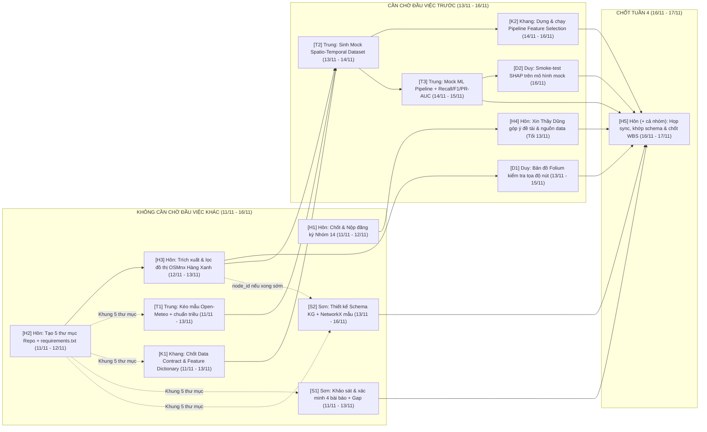

# KẾ HOẠCH THỰC HIỆN ĐỒ ÁN TUẦN 4 (11/11 – 17/11/2026)
## MÔN: MÁY HỌC NÂNG CAO (`CS315.G12.LT.TTNT`) — NHÓM 14

> **Khoảng thời gian:** Thứ Tư `11/11/2026` – Thứ Ba `17/11/2026` (Tuần 4 — Fast-track Sprint)  
> **Tài liệu tham chiếu:** [De_Cuong_Chi_Tiet_Do_An_May_Hoc_Nang_Cao.md](./De_Cuong_Chi_Tiet_Do_An_May_Hoc_Nang_Cao.md) | [Ke_Hoach_Thuc_Hien_Do_An_May_Hoc_Nang_Cao.xlsx](./Ke_Hoach_Thuc_Hien_Do_An_May_Hoc_Nang_Cao.xlsx) | [README.md](./README.md)  
> **Phạm vi tài liệu:** Chỉ liệt kê các đầu việc **thuộc Đồ án CS315** của 5 thành viên trong Tuần 4; mỗi đầu việc ghi rõ **Đầu vào (Inputs)**, trạng thái **Chờ người khác hoàn thành**, **Sản phẩm bàn giao** và **lưu ý kỹ thuật** — toàn bộ quy trình tự chủ 100% trong `CS315`, không phụ thuộc môn học khác.  
> **Quy ước tái sử dụng mã nguồn:** Các file `.py` khởi tạo trong Tuần 4 đóng vai trò module lõi để các notebook Colab Tuần 5–7 (`01_Feature_Selection.ipynb`, `02_Model_Training.ipynb`, `03_Traffic_KG_Agent_Demo.ipynb`) import trực tiếp, tránh trùng lặp code.

---

## I. SƠ ĐỒ PHỤ THUỘC ĐẦU VIỆC (AI LÀM LUÔN – AI CHỜ AI?)

---

## II. MA TRẬN PHỤ THUỘC TỔNG HỢP GIỮA 5 THÀNH VIÊN

| Thành viên | MSSV | Đầu việc làm được NGAY (Không chờ ai) | Đầu việc PHẢI CHỜ người khác | Vai trò mở khóa cho người sau |
| :--- | :---: | :--- | :--- | :--- |
| **Trần Hoàng Hôn** *(Trưởng nhóm / PM)* | `26410046` | `[H2]`, `[H3]` | • `[H1]` (bản nháp trên file lớp đã điền sẵn; chỉ chờ 4 thành viên xác nhận câu chữ 10p trên Zalo + tô màu nền trước khi nộp) • `[H4]` (cần `[H1]` xong trước `13/11`) • `[H5]` (chờ `[K2]`, `[T3]`, `[D1]`, `[D2]`, `[S1]`, `[S2]` vào `16/11–17/11`) | **`[H3]` là nút mở khóa chính của tuần** — hoàn tất trước tối `13/11` để Duy (`[D1]`) và Trung (`[T2]`) có `15–25` nút giao & cạnh đường thật. |
| **Phạm Thành Trung** *(Kỹ sư AI & ML)* | `26410141` | `[T1]` | • `[T2]` (**chờ `[H3]` của Hôn** + `[K1]` của Khang) • `[T3]` (chờ `[T2]` của chính Trung; chốt xong trước tối `15/11`) | **`[T2]` & `[T3]` mở khóa** cho Khang kiểm thử `[K2]` (`14/11–16/11`) và Duy chạy `[D2]` (`16/11`). |
| **Nguyễn Duy Khang** *(Dữ liệu & Feature Selection)* | `26410055` | `[K1]` | • `[K2]` (viết khung code ngay được sau `[K1]` & đối chiếu demo Colab của Thầy tối `13/11`; để **chạy kiểm thử** phải **chờ `[T2]` của Trung**) | **`[K1]` mở khóa** quy ước tên cột, quy tắc nội suy `1h -> 15'` và biến phân loại cho `[T2]` của Trung. |
| **Vũ Văn Duy** *(XAI & GIS Heatmap)* | `26410031` | *(Đọc trước vị trí điểm ngập Bình Thạnh trong khi chờ `[H3]`)* | • `[D1]` (**chờ `[H3]` của Hôn** xuất `nodes.csv` & `edges.csv`) • `[D2]` (**chờ `[T3]` của Trung** xong trước tối `15/11` để chạy ngày `16/11`) | Báo cáo kết quả kiểm tra chéo tọa độ thực địa và xác nhận tương thích `SHAP` trên tên biến gốc tại buổi sync `[H5]`. |
| **Hoàng Cao Sơn** *(Traffic KG & Agent — Lead `WBS-03`)* | `25730061` | `[S1]`, `[S2]` | **Không cần chờ bất kỳ ai** trong Tuần 4 *(có thể lấy sớm `node_id` từ `[H3]` sau `13/11` nếu đã có, và đối chiếu chốt tại `[H5]`)* | Hoàn thành `[S1]` trước tối `13/11` giúp Hôn trả lời Thầy Dũng sâu hơn ở `[H4]`. |

---

## III. KẾ HOẠCH CHI TIẾT TỪNG THÀNH VIÊN (11/11 – 17/11/2026)

### 1. Trần Hoàng Hôn (`26410046`) — Trưởng nhóm / PM & Đồ thị giao thông (`Lead WBS-02`)
*Định mức đồ án CS315 Tuần 4: ~2.5–3.0 giờ (đã tính họp sync/PM; tự chủ hoàn toàn trích xuất đồ thị OSMnx ngay trong repo CS315)*

| Mã CV & Hạn | Đầu việc Đồ án | Đầu vào (Inputs) | Chờ người khác hoàn thành? | Sản phẩm bàn giao (Deliverables) |
| :--- | :--- | :--- | :--- | :--- |
| **`[H1]`** 11/11 – 12/11 | Hoàn thiện định dạng, chốt nội dung đăng ký cùng 4 bạn & nộp Nhóm `14` lên thư mục lớp | • Mẫu Cột D & Cột E tại Mục IV.1 của file ngoài repo `Máy học nâng cao/Ke_Hoach_Hoc_Tap_May_Hoc_Nang_Cao.md` • File ngoài repo `Máy học nâng cao/DS_Nhom_CS315.G12.LT.TTNT.xlsx` (hàng `45–49` đã điền sẵn nội dung & merge ô) | **Chờ nhẹ (10 phút):** Tô màu nền phân biệt cho hàng `45–49`, gửi 4 thành viên (`Khang, Trung, Duy, Sơn`) xác nhận câu chữ qua Zalo rồi upload lên Drive lớp. | • Nhóm `14` trên `DS_Nhom_CS315.G12.LT.TTNT.xlsx` đủ Cột D, Cột E, tô màu nền chuẩn và nộp đúng hạn trước `12/11`. |
| **`[H2]`** 11/11 – 12/11 | Khởi tạo cấu trúc 5 thư mục Repo & danh sách thư viện chuẩn | • Cấu trúc thư mục Mục VI.4 trong `Ke_Hoach_Hoc_Tap_May_Hoc_Nang_Cao.md` • Danh sách công nghệ trong [README.md](./README.md) | **Không cần chờ ai (Làm ngay).** | • 5 thư mục: `01_data_sample/`, `02_feature_selection/`, `03_models_evaluation/`, `04_knowledge_graph_demo/`, `05_report_slides/` + `requirements.txt` (giữ `.py` làm module cho `.ipynb` tuần sau; bổ sung `.gitignore` cho `.venv/`, `.env`, `.ipynb_checkpoints/`). |
| **`[H3]`** 12/11 – 13/11 *(xong trước tối 13/11)* | Trích xuất & lọc gọn đồ thị mạng lưới đường cụm Hàng Xanh bằng `OSMnx` | • Tọa độ tâm Ngã tư Hàng Xanh `(10.8012, 106.7114)` (`dist=1000m`, `network_type='drive'`, `simplify=True`) • 6 trục đường giới hạn tại Mục I.5 của [De_Cuong_Chi_Tiet_Do_An_May_Hoc_Nang_Cao.md](./De_Cuong_Chi_Tiet_Do_An_May_Hoc_Nang_Cao.md) (XVNT, Đinh Bộ Lĩnh, Bạch Đằng, Điện Biên Phủ, Nguyễn Gia Trí/D2, Ung Văn Khiêm) | **Không cần chờ ai** (chỉ cần thư mục `01_data_sample/` từ `[H2]`). *Lưu ý kỹ thuật:* Bán kính `1000m` nội đô mặc định sẽ sinh hàng trăm–hàng nghìn nút hẻm; **bắt buộc dùng `custom_filter` lọc đường chính (`primary`/`secondary`/`tertiary`) hoặc lọc theo 6 trục đường + gộp cụm nút kề** để rút gọn đúng `15–25` nút giao trọng điểm. | • Script `01_data_sample/extract_hang_xanh_graph.py` • `01_data_sample/nodes.csv` (`15–25` nút có `node_id`, `lat`, `lon`), `edges.csv` (kèm `highway`, `lanes`, `length`, `oneway`), `adjacency_matrix.csv`, `hang_xanh.graphml`. |
| **`[H4]`** Tối 13/11 | Tham vấn Thầy Đặng Việt Dũng duyệt phạm vi đề tài & phương án 2 nhánh nguồn dữ liệu cuối buổi học | • Nội dung đăng ký Nhóm `14` từ `[H1]` • Số liệu nút/cạnh sơ bộ `[H3]` & bảng Research Gap `[S1]` | **Chờ `[H1]`** (nộp xong trước `13/11`). Nên có thêm `[S1]` từ Sơn & số liệu `[H3]` trước 18h30 ngày `13/11`. *Cần hỏi rõ Thầy:* (1) Xin Thầy duyệt & góp ý phạm vi đề tài Nhóm `14` trên `DS_Nhom_CS315.G12.LT.TTNT.xlsx`; (2) Xác nhận phương án 2 nhánh dữ liệu Tuần 5: chạy đối chứng thuật toán trên tập cảm biến thật `METR-LA` kết hợp kịch bản đặc thù TP.HCM (đồ thị `OSMnx` + thời tiết `Open-Meteo` + bảng lịch triều cường trạm Phú An + lưu lượng Hàng Xanh mô phỏng tăng cường). | • `05_report_slides/bien_ban_gop_y_thay_13_11.md` chốt phạm vi bài toán, lộ trình 2 nhánh dữ liệu Tuần 5 và các lưu ý điều chỉnh từ Thầy Dũng. |
| **`[H5]`** 16/11 – 17/11 | Điều phối họp sync nhóm, khớp schema/node_id, hợp nhất GitHub & cập nhật tiến độ | • Toàn bộ sản phẩm `[K2]`, `[T3]`, `[D1]`, `[D2]`, `[S1]`, `[S2]` • [Ke_Hoach_Thuc_Hien_Do_An_May_Hoc_Nang_Cao.xlsx](./Ke_Hoach_Thuc_Hien_Do_An_May_Hoc_Nang_Cao.xlsx) & file `Ke_Hoach_Hoc_Tap_May_Hoc_Nang_Cao.xlsx` | **Chờ `[K2]`, `[T3]`, `[D1]`, `[D2]`, `[S1]`, `[S2]` hoàn thành** trước khi rà soát chéo, khớp tập đặc trưng `[K2]` với `[T3]` và đối chiếu `node_id` với `[S2]`. | • Nhánh `main` GitHub hợp nhất đủ sản phẩm Tuần 4 + cập nhật `%` Tuần 4 trong [Ke_Hoach_Thuc_Hien_Do_An_May_Hoc_Nang_Cao.xlsx](./Ke_Hoach_Thuc_Hien_Do_An_May_Hoc_Nang_Cao.xlsx) và trạng thái `WBS-02`, `WBS-03` trong `Ke_Hoach_Hoc_Tap_May_Hoc_Nang_Cao.xlsx` (sheet `02_Quan_Ly_Do_An_Nhom`). |

---

### 2. Phạm Thành Trung (`26410141`) — Kỹ sư AI & Mô hình hóa ML
*Định mức đồ án CS315 Tuần 4: ~2.5–3.0 giờ | Tự chủ thu thập `Open-Meteo` & sinh dữ liệu mock ngay trong CS315, không phụ thuộc môn khác*

| Mã CV & Hạn | Đầu việc Đồ án | Đầu vào (Inputs) | Chờ người khác hoàn thành? | Sản phẩm bàn giao (Deliverables) |
| :--- | :--- | :--- | :--- | :--- |
| **`[T1]`** 11/11 – 13/11 | Trích xuất mẫu chuỗi thời gian thời tiết `Open-Meteo` & chuẩn hóa bảng lịch triều cường Phú An | • Tọa độ Ngã tư Hàng Xanh `(10.8012, 106.7114)` • API công khai `Open-Meteo` (`precipitation`, `relative_humidity_2m`, `temperature_2m` theo giờ) • Bảng lịch mực nước & ngưỡng tham chiếu triều cường trạm Phú An (`tide_level`) theo [De_Cuong_Chi_Tiet_Do_An_May_Hoc_Nang_Cao.md](./De_Cuong_Chi_Tiet_Do_An_May_Hoc_Nang_Cao.md#L107) | **Không cần chờ ai (Làm ngay).** | • `01_data_sample/open_meteo_sample.csv` (chuỗi thời gian chuẩn hóa `UTC+7` đủ nhiều ngày để đồng bộ mock) + `01_data_sample/phu_an_tide_reference.csv` (số hóa lịch đỉnh/chân triều trạm Phú An trùng mốc ngày với `Open-Meteo`, làm nền chuẩn cho `tide_level` thay vì sinh số ngẫu nhiên). |
| **`[T2]`** 13/11 – 14/11 | Sinh bộ dữ liệu giả lập không gian-thời gian (`Mock Dataset`) phục vụ chạy thử pipeline | • `01_data_sample/nodes.csv` & `edges.csv` (từ `[H3]`) • `01_data_sample/open_meteo_sample.csv` & `01_data_sample/phu_an_tide_reference.csv` (từ `[T1]`) • `02_feature_selection/feature_dictionary.md` (từ `[K1]`) | **BẮT BUỘC CHỜ:** 1. **`[H3]` của Hôn** (lấy `15–25` `node_id`, cạnh kề và thuộc tính đường `highway`/`lanes`/`oneway`). 2. **`[K1]` của Khang** (khớp tên cột, quy tắc nội suy thời tiết `1h -> 15'`, biến phân loại *Nominal/Ordinal* và 3 cột nhãn). | • `01_data_sample/mock_hang_xanh_traffic_weather.csv` (`~2.500–5.000` dòng tương ứng `150–300` bước `15'` $\times$ `15–25` nút; có biến số, `tide_level`, biến phân loại như `road_type`, `time_slot`, `rain_level` và có kịch bản mưa $>30\text{ mm/h}$ để mọi fold đều có nhãn `0, 1, 2` tại `y_t15`, `y_t30`, `y_t60`). |
| **`[T3]`** 14/11 – 15/11 *(xong trước tối CN 15/11)* | Xây dựng Mock Pipeline huấn luyện Baseline ML & hàm thẩm định `Recall`/`F1`/`PR-AUC` | • `01_data_sample/mock_hang_xanh_traffic_weather.csv` (từ `[T2]`) • Yêu cầu kỹ thuật Mục I.3 & I.7 trong [De_Cuong_Chi_Tiet_Do_An_May_Hoc_Nang_Cao.md](./De_Cuong_Chi_Tiet_Do_An_May_Hoc_Nang_Cao.md) (`TimeSeriesSplit`, mục tiêu `Recall >= 85%`, `F1 >= 80%`) | **Chờ `[T2]` của chính Trung** (gián tiếp chờ `[H3]` & `[K1]`). *Lưu ý kỹ thuật:* Phải chia `TimeSeriesSplit` theo **mốc thời gian duy nhất (`unique timestamp`)** chứ không cắt ngang dòng giữa các nút; tính `PR-AUC` theo **One-vs-Rest cho lớp `2`**; xuất model mock dùng **tên đặc trưng gốc (không qua PCA)** để Duy chạy `[D2]` ngày `16/11`. | • Script `03_models_evaluation/mock_ml_pipeline.py` (chia `TimeSeriesSplit` theo `timestamp`, chạy baseline `RandomForest` / `LightGBM` với `class_weight='balanced'` trên `y_t15` hoặc vòng lặp 3 mốc `15', 30', 60'`, xuất `Recall` lớp `2`, `Macro-F1`, One-vs-Rest `PR-AUC` lớp `2`, `Confusion Matrix` & lưu model mock). |

---

### 3. Nguyễn Duy Khang (`26410055`) — Kỹ sư Dữ liệu & Feature Selection
*Định mức đồ án CS315 Tuần 4: ~2.0–2.5 giờ | Đối chiếu với code demo Colab của Thầy Dũng tối Thứ Sáu `13/11`*

| Mã CV & Hạn | Đầu việc Đồ án | Đầu vào (Inputs) | Chờ người khác hoàn thành? | Sản phẩm bàn giao (Deliverables) |
| :--- | :--- | :--- | :--- | :--- |
| **`[K1]`** 11/11 – 13/11 | Thiết kế Data Contract & Từ điển đặc trưng (`Feature Dictionary`) | • Danh sách biến dự kiến tại Mục V của `Week 2/Tong_Hop_Tuan_2_May_Hoc_Nang_Cao.md` & Nội dung 2 trong [De_Cuong_Chi_Tiet_Do_An_May_Hoc_Nang_Cao.md](./De_Cuong_Chi_Tiet_Do_An_May_Hoc_Nang_Cao.md#L126-L129) • Trường thời tiết `[T1]` + thuộc tính đường từ `[H3]` | **Không cần chờ ai xong code (Làm ngay)** — nhắn chốt nhanh `node_id`/thuộc tính cạnh với Hôn và tên biến thời tiết với Trung. *Bắt buộc chốt rõ:* Quy tắc nội suy `Open-Meteo` (`1h -> 15'`), biến `tide_level`, biến *Ordinal* (`time_slot`, `rain_level`), biến *Nominal* (`road_type`, `oneway`) và tên nhãn `y_t15`, `y_t30`, `y_t60`. | • `02_feature_selection/feature_dictionary.md` (bảng schema cột, kiểu dữ liệu, đơn vị, quy tắc phân tách biến số / *Ordinal* / *Nominal* và kỹ thuật lọc tương ứng). |
| **`[K2]`** 14/11 – 16/11 | Xây dựng module Feature Selection 2 nhánh + nhánh đối chứng PCA & kiểm thử trên mock dataset | • `02_feature_selection/feature_dictionary.md` (từ `[K1]`) • `01_data_sample/mock_hang_xanh_traffic_weather.csv` (từ `[T2]`) • Notebook demo Feature Selection của Thầy Dũng tối `13/11` | **Viết khung code sau `[K1]` (cập nhật theo demo `13/11` của Thầy); CHẠY KIỂM THỬ phải chờ `[T2]` của Trung.** *Lưu ý kỹ thuật:* (1) Không ép `PCA` vào đầu ra chính của mô hình cây/`SHAP`, chỉ tách `PCA` thành nhánh thử nghiệm/đối chứng riêng; (2) Với nhãn **3 lớp**, ngưỡng tới hạn $\chi^2$ ($\alpha=0.05, df=2$) là **`5.99`** (không dùng `3.84`); (3) `Pearson` chỉ tính trên biến số và cảnh báo không lọc cứng làm mất biến mưa/triều phi tuyến; (4) `fit` các bước có giám sát chỉ trên tập `train` của fold để tránh `Data Leakage`. | • Script `02_feature_selection/01_feature_selection_pipeline.py` gồm: nhánh số (`VarianceThreshold` + `Pearson r` tham khảo), nhánh phân loại (`OrdinalEncoder` / `OneHotEncoder` + $\chi^2 > 5.99$), hàm `fit` theo từng fold `train`, và nhánh đối chứng `PCA` tách riêng. |

---

### 4. Vũ Văn Duy (`26410031`) — Kỹ sư Giải thích XAI & GIS Heatmap
*Định mức đồ án CS315 Tuần 4: ~2.0–2.5 giờ*

| Mã CV & Hạn | Đầu việc Đồ án | Đầu vào (Inputs) | Chờ người khác hoàn thành? | Sản phẩm bàn giao (Deliverables) |
| :--- | :--- | :--- | :--- | :--- |
| **`[D1]`** 13/11 – 15/11 | Dựng bản đồ GIS (`Folium`) kiểm tra tọa độ nút thực địa & điểm ngập | • `01_data_sample/nodes.csv` & `edges.csv` (từ `[H3]`) • Danh sách điểm trũng dễ ngập Bình Thạnh (Đinh Bộ Lĩnh, XVNT đoạn gần cầu Bình Triệu, Ung Văn Khiêm) từ Mục I.1 & I.5 của [De_Cuong_Chi_Tiet_Do_An_May_Hoc_Nang_Cao.md](./De_Cuong_Chi_Tiet_Do_An_May_Hoc_Nang_Cao.md) | **BẮT BUỘC CHỜ `[H3]` của Hôn** xuất đủ `15–25` nút và cạnh đường đã lọc gọn. | • Script `01_data_sample/build_gis_check_map.py` • Bản đồ `01_data_sample/hang_xanh_gis_check.html` + ghi chú nút lệch tọa độ, điểm ngập hoặc sai chiều đường một chiều. |
| **`[D2]`** 16/11 | Chạy thử nghiệm tương thích `SHAP TreeExplainer` trên mô hình mock | • Model baseline mock (dùng đặc trưng gốc, không qua PCA) & tập dữ liệu mẫu từ `[T3]` | **BẮT BUỘC CHỜ `[T3]` của Trung** (chốt xong trước tối `15/11`). | • Script/hàm kiểm tra `shap.TreeExplainer` chạy thông trên tên biến gốc (lượng mưa, nút nguồn, giờ cao điểm...) + xác nhận phiên bản `shap` tương thích trong `requirements.txt`. |

---

### 5. Hoàng Cao Sơn (`25730061`) — Kỹ sư Đồ thị tri thức (`GraphRAG`) & AI Agent *(Lead `WBS-03`)*
*Định mức đồ án CS315 Tuần 4: ~2.0–2.5 giờ — Luồng Traffic KG & Literature Survey chạy song song độc lập*

| Mã CV & Hạn | Đầu việc Đồ án | Đầu vào (Inputs) | Chờ người khác hoàn thành? | Sản phẩm bàn giao (Deliverables) |
| :--- | :--- | :--- | :--- | :--- |
| **`[S1]`** 11/11 – 13/11 | Khảo sát, **xác minh nguồn gốc** 4 công trình liên quan & tổng hợp bảng `Research Gap` | • 4 hướng tài liệu gợi ý tại Mục I.1 của [De_Cuong_Chi_Tiet_Do_An_May_Hoc_Nang_Cao.md](./De_Cuong_Chi_Tiet_Do_An_May_Hoc_Nang_Cao.md#L46-L52) (STGCN, Multi-modal GAT thời tiết khắc nghiệt, nghiên cứu ngập TP.HCM, nghiên cứu Traffic KG) | **Không cần chờ bất kỳ ai (Làm ngay từ `11/11`).** *Lưu ý:* Trong Đề cương, 4 mục này mới ở dạng tên/tạp chí tóm tắt và chưa có tên tác giả hay DOI; cần tra cứu lại **chính xác tên bài báo, tác giả, năm và hội nghị/tạp chí gốc** trước khi trích dẫn. Nên xong trước 18h30 `13/11` để hỗ trợ Hôn tại `[H4]`. | • `05_report_slides/literature_survey_notes.md` (trích dẫn chuẩn tác giả/năm/venue + bảng so sánh: Phương pháp – Dữ liệu – Khoảng trống nghiên cứu). |
| **`[S2]`** 13/11 – 16/11 | Thiết kế Schema *Traffic Knowledge Graph* & Prototype truy vấn `NetworkX` | • Kịch bản mục tiêu Nội dung 5 trong [De_Cuong_Chi_Tiet_Do_An_May_Hoc_Nang_Cao.md](./De_Cuong_Chi_Tiet_Do_An_May_Hoc_Nang_Cao.md#L138-L141) • 6 tuyến đường cụm Hàng Xanh *(tùy chọn lấy sớm `node_id` từ `[H3]` sau `13/11`)* | **Không cần chờ dữ liệu giao thông hay kết quả model ML** để thiết kế Ontology và chạy prototype `6–7` nút mẫu. *Chỉ đối chiếu khớp quy ước `node_id` cuối cùng với Hôn tại buổi sync `[H5]` (`16/11–17/11`).* | • `04_knowledge_graph_demo/traffic_kg_schema.md` • `04_knowledge_graph_demo/traffic_kg_schema.py` chạy truy vấn mẫu gợi ý lộ trình né kẹt khi mưa $>30\text{ mm/h}$ (làm nền cho `03_Traffic_KG_Agent_Demo.ipynb`). |

---

## IV. CHECKLIST NGHIỆM THU TUẦN 4 (`DEFINITION OF DONE` — HẠN `17/11/2026`)

- [ ] **Hồ sơ & Tham vấn (`[H1]`, `[H4]`):** Nhóm `14` đã tô màu nền, chốt Zalo, nộp `DS_Nhom_CS315.G12.LT.TTNT.xlsx` lên Drive lớp trước `12/11`; lưu biên bản góp ý của Thầy Dũng tối `13/11` (chốt rõ lộ trình 2 nhánh dữ liệu Tuần 5: `METR-LA` đối chứng + Hàng Xanh).
- [ ] **Cấu trúc đồ thị & GIS (`[H3]`, `[D1]`):** Xuất đủ `nodes.csv` (`15–25` nút giao trọng điểm đã lọc hẻm), `edges.csv`, `adjacency_matrix.csv` và kiểm chứng tọa độ thực địa trên `hang_xanh_gis_check.html`.
- [ ] **Tiền xử lý & Mock ML (`[K1]`, `[K2]`, `[T1]–[T3]`, `[D2]`):** Chốt `feature_dictionary.md`; chạy thông pipeline Feature Selection (không `Data Leakage`, $\chi^2 > 5.99$ cho 3 lớp, tách riêng nhánh `PCA`); chạy `mock_ml_pipeline.py` chia `TimeSeriesSplit` theo `unique timestamp` (xuất `Recall` lớp `2`, `Macro-F1`, One-vs-Rest `PR-AUC` lớp `2`, `Confusion Matrix`) + smoke-test `shap.TreeExplainer` trên tên biến gốc.
- [ ] **Đồ thị tri thức & Tài liệu (`[S1]`, `[S2]`):** Hoàn thành `literature_survey_notes.md` với trích dẫn gốc đã kiểm chứng và prototype *Traffic Knowledge Graph* trên `NetworkX` trả lời được kịch bản cảnh báo lộ trình khi mưa lớn.
- [ ] **Đồng bộ cuối tuần (`[H5]`):** Cả 5 thành viên họp sync `16/11–17/11`, hợp nhất sản phẩm lên nhánh `main` GitHub (không có link hỏng) và cập nhật `%` Tuần 4 trong [Ke_Hoach_Thuc_Hien_Do_An_May_Hoc_Nang_Cao.xlsx](./Ke_Hoach_Thuc_Hien_Do_An_May_Hoc_Nang_Cao.xlsx) cùng `WBS-02`/`WBS-03` trong `Ke_Hoach_Hoc_Tap_May_Hoc_Nang_Cao.xlsx`.
